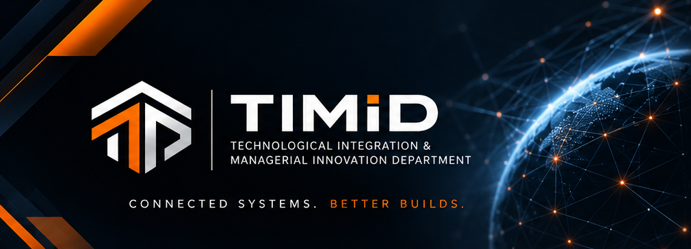
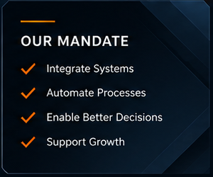
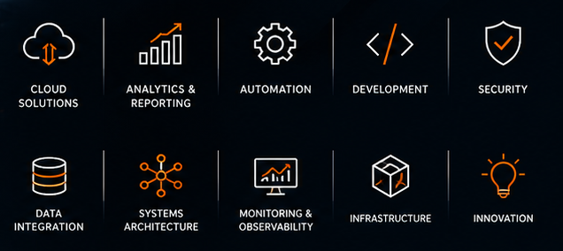
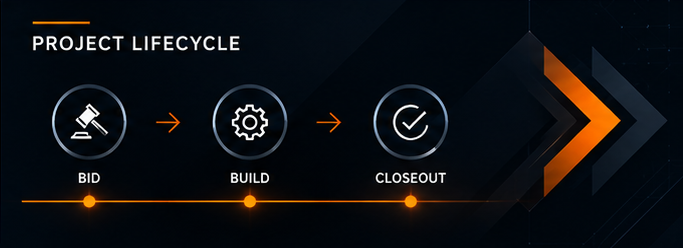

*World of Warcraft addons, built with the seriousness of a heavy civil construction firm and the urgency of a guy who just missed a fishing pool.*

📣 **New: [Introducing Forever Ding](https://github.com/TIMID-Group/WoW-Forever-Addons/discussions/50)**

-brightgreen)

---

## 📋 Overview

The Technological Integration and Managerial Innovation Department (TIMID) is pivotal in driving Azeroth toward a technologically advanced and efficiently managed future. TIMID integrates cutting-edge Lua, optimizes in-game processes, and fosters a culture of continuous innovation to enhance operational efficiency and productivity for one (1) player and anyone else who wants it.

### 🔭 Vision

To lead the player base into a future defined by technological excellence and innovative UI practices, ensuring our users remain at the forefront of fishing advancements.

### 🎯 Mission

To seamlessly integrate useful tools into the game client, eliminate repetitive tasks, and ensure sustained growth of the user's bags, gold, and fishing skill.

---

## 📦 Product Portfolio

| Division | Status |
|---|---|
| **[WoW Forever Addons](https://github.com/TIMID-Group/WoW-Forever-Addons)**: five addons for the WoW Forever client (fishing, professions, the auction house and quest clean-up) | Released |
| *Next project* | Under review by the Board. Pending managerial approval (the manager is also the developer). |

| | Addon | Status | Description |
|---|---|---|---|
| 🎣 | **Forever Fishing Chart** | Released, invite only | Interactive fishing map built on the game's own world map. Waters, skill requirements, time-of-day rates and catch data where you actually need them, plus a fish finder and your own catch log. |
| 🛠️ | **Forever Workbench** | Released, invite only | A richer profession window: materials on hand on every recipe, vendor materials bought for you, your crafts sold back, and a crafting queue that buys, crafts and sells for you, step by step. |
| 📒 | **Forever Crafting Ledger** | Released, invite only | What every recipe earns, from your cheapest materials to the best place to sell, with named shopping lists. |
| 📜 | **Forever Quest Leftovers** | Released, invite only | Finds items in your bags and bank that no quest needs any more and says what to do with each. It only advises. |
| 🔔 | **Forever Ding** | Released, invite only | Adds up the XP of the quests you can hand in and says whether you will level: in this zone and everywhere, or how much XP you would still need. |
| 🛩️ | **TIMID Skunkworks** | Classified | Projects in development. Details are need-to-know. |

Access to each addon is by invitation: [request access here](https://github.com/TIMID-Group/WoW-Forever-Addons/issues/new?template=request_access.yml).

---

## ⚙️ Key Functions

*All ten capabilities are delivered by the same person, usually between fishing pools.*

### 1. Data Integration
- **Objective:** Get the right information onto the screen at the right time.
- **Metrics:**
  - Time spent alt-tabbing to a wiki
  - Number of browser tabs open while playing
  - Zones fished without knowing the skill requirement

### 2. Automated Systems Integration
- **Objective:** Automate the boring parts.
- **Metrics:**
  - Percentage of repetitive tasks automated
  - Reduction in manual errors (wrong zone, wrong bait, wrong everything)
  - Time saved, reinvested into more fishing

### 3. Interface Optimization
- **Objective:** Streamline the UI for better efficiency and effectiveness.
- **Metrics:**
  - Frame rate impact (target: none)
  - Screen space consumed (target: as little as possible)
  - User satisfaction with settings panels

### 4. Prototype to Production Pipeline
- **Objective:** Test features in a web playground, then ship them in-game.
- **Metrics:**
  - Features validated before release
  - On-time delivery rates (see Known Risks)
  - Bugs caught before the user catches them

### 5. Equipment Technologies Management
- **Objective:** Know where the fishing pole is.
- **Metrics:**
  - Equipment downtime
  - Lures applied versus lures forgotten
  - Fishing poles accidentally vendored (target: 0)

---

## 🏗️ Project Lifecycle

| Phase | What it means at TIMID |
|---|---|
| **Bid** | A player reports a problem or an idea from inside the game. The Board (one person) accepts the bid. |
| **Build** | The department designs it, builds it and runs thousands of tests against a fake World of Warcraft. |
| **Closeout** | A release ships through WowUp, the report is answered and closed, and the punch list is filed. |

## 💼 Additional Value Propositions

**Seamless Integration Between All Stages of Fishing**
Smooth transitions from cast to bobber to loot to next cast. Metric: reduction in transition-related delays.

**Company-Wide Software Standardization**
Every TIMID addon follows the same structure, settings conventions, and slash command style, so learning one teaches you all of them.

**Reduced Complexity and Increased Data Accuracy**
Simple tools with correct data beat clever tools with wrong data. Community corrections are welcome and encouraged (see [Correspondence](#-correspondence)).

**Strategic Flexibility**
Whether the realm grows, the patch changes, or the department reduces in size (it is already one person), TIMID provides a systematic infrastructure adaptable to any scenario.

---

## ✅ Benefits

1. **Enhanced Efficiency:** Less looking things up, more doing things.
2. **Improved Safety:** Fewer deaths from fishing in the wrong zone at the wrong level.
3. **Cost Savings:** Gold that would have been wasted is not wasted.
4. **Competitive Advantage:** You get to the pool first.

> [!IMPORTANT]
> *"Happy Angler is a Safe Raid."* TIMID Group Safety Policy

---

## 📈 Strategic Goals

1. 100% automation of repetitive tasks within two years, or one expansion, whichever comes later.
2. 50% reduction in time spent on third-party websites.
3. Zero (0) taint errors attributable to TIMID addons.
4. 95% user satisfaction with settings menus.
5. Accurate and timely data integration as new information is discovered.
6. A scalable addon framework adaptable to any game version or scope of work.

---

## ⚠️ Known Risks

- Department staffing is limited to one developer who is also finishing an engineering degree.
- Delivery schedules are subject to exam season.
- Patches may change things without notice. TIMID will respond with urgency proportional to how badly it breaks fishing.

---

## 📮 Correspondence

Installation, access requests, problem reports and ideas are handled by the **[WoW Forever Addons](https://github.com/TIMID-Group/WoW-Forever-Addons)** front office. Pull requests will be reviewed by the full Board of Directors (one person) at their earliest convenience.

---

## 🏁 Conclusion

By installing a TIMID addon, you commit to a future of continuous improvement, technological excellence, and innovative fishing. TIMID ensures you are well equipped to meet the demands of tomorrow, regardless of growth, new ventures, or contraction of your bag space.

*MIT licensed, copyright TIMID Group. TIMID Group is not affiliated with Blizzard Entertainment. World of Warcraft is a trademark of Blizzard Entertainment, Inc.*
